# TÀI LIỆU QUY HOẠCH & BÀN GIAO DỰ ÁN
## HỆ THỐNG GIÁM SÁT TRẠM TRỘN BÊ TÔNG NHỰA NÓNG ASPHALT ENQ 01
**Đơn vị:** CÔNG TY TNHH THIẾT BỊ CÔNG TRÌNH VIỆT NAM  
**Phiên bản:** 2.0 (Chạy thật & Quản lý toàn diện) | **Ngày:** 12/10/2026

---

## 1. TỔNG QUAN HỆ THỐNG & MỤC TIÊU DỰ ÁN
Hệ thống phần mềm giám sát trạm trộn bê tông nhựa nóng Asphalt (ENQ 01) được xây dựng nhằm mục đích tự động hóa 100% quy trình thu thập số liệu mẻ trộn, chuyến xe từ máy tính điều khiển công nghiệp (Siemens WinCC) và truyền phát trực tiếp lên Cloud Web Dashboard.

Ban giám đốc và kỹ sư điều hành có thể theo dõi sản lượng, khối lượng mẻ, thành phần cốt liệu, nhựa đường, phụ gia theo thời gian thực từ điện thoại hoặc máy tính cá nhân ở bất cứ đâu.

- **Trạm sản xuất:** Trạm Trộn Asphalt ENQ 01
- **Đơn vị chủ quản:** CÔNG TY TNHH THIẾT BỊ CÔNG TRÌNH VIỆT NAM
- **Địa chỉ máy chủ Cloud:** `https://tram-tron-net.onrender.com`
- **Tài khoản đăng nhập mặc định:** `admin` / `123456`
- **Kho lưu trữ GitHub:** `https://github.com/oPSDo/BPAC_WEB` (Local: `C:\Users\Admin\Documents\GitHub\oPSDo\BPAC_WEB`)
- **Bản sao lưu Google Drive:** `M:\My Drive\Dev\ENQ\TramTron_Web\ENQ_WEB`

---

## 2. QUY HOẠCH CẤU TRÚC THƯ MỤC CHUẨN

Toàn bộ không gian làm việc của dự án được quy hoạch phân chia rõ ràng làm 3 phân vùng độc lập:

| Thư mục / Phân vùng | Nhiệm vụ chính | Ghi chú & Tệp tin trọng yếu |
| :--- | :--- | :--- |
| **`BPAC_PC/`** | Tool chạy tự động máy trạm | `autoupdate.exe`, `BPAC.exe`, `autoupdate_config.json`, file zip `BPAC_CaiDat_MayThat.zip` |
| **`ENQ_WEB/`** (`BPAC_WEB`) | Toàn bộ mã nguồn Web Server Node.js | `server.js`, `app.js`, `routes/`, `views/`, `services/`, `data/` để deploy Render |
| **`Other/`** | Tài nguyên lưu trữ & File mẫu | File Excel mẫu, thư mục OLD, tài liệu kỹ thuật không đẩy lên git |
| ├── **`data/`** | Kho dữ liệu JSON bền vững | `production_data.json` (dữ liệu thật), `macs.json`, `customers.json`, `vehicles.json` |
| ├── **`services/`** | Logic nghiệp vụ & Bóc tách | `excelParser.js` (phân tích file WinCC), `dataStore.js` (CRUD & thống kê KPI) |
| ├── **`routes/`** | Tuyến đường API & Điều hướng | `api.js` (upload/ping/reset), `dashboard.js` (render giao diện & CRUD) |
| ├── **`views/`** | Giao diện EJS chuẩn FUTA | `home.ejs`, `macs.ejs`, `customers.ejs`, `vehicles.ejs`, `phieus.ejs`... |
| └── **`public/css/`** | Tài nguyên tĩnh | `app.css` (chuẩn màu sắc, bảng 3 cột, responsive mobile, modal popup) |

---

## 3. LUỒNG HOẠT ĐỘNG DỮ LIỆU TỰ ĐỘNG (WORKFLOW)

```mermaid
flowchart LR
    A["WinCC Siemens\n(Trạm trộn xả mẻ)"] -->|"Xuất file .xls"| B["Thư mục LuuDL_BPAC\n(Máy tính trạm)"]
    B -->|"Quét 15s/lần"| C["autoupdate.exe\n(Tool chạy ngầm)"]
    C -->|"HTTP POST /api/upload"| D["Server Node.js\n(tram-tron-net.onrender.com)"]
    D -->|"excelParser.js"| E["Bóc tách thành phần\n(CL, Nhựa, PG, M3)"]
    E -->|"dataStore.js"| F["Ghi production_data.json\n& Cập nhật KPI"]
    F -->|"Web Socket / Refresh"| G["Dashboard PC & Mobile\n(/home & /phieus)"]
```



1. **Máy trộn xả mẻ:** WinCC trạm trộn xuất file Excel theo ca hoặc xe vào thư mục cấu hình (`D:\BPAC_2026RT\LuuDL_BPAC\2026_10_12\Ghi_CaXe_...xls` hoặc `Ghi_CTXe_...xls`).
2. **AutoUpdate Agent:** File `autoupdate.exe` chạy nền, cứ 15 giây quét thư mục một lần. Khi phát hiện file mới, tự động gửi HTTP POST Multipart lên `https://tram-tron-net.onrender.com/api/upload` kèm API Key `BPAC_SECRET_KEY_2026`.
3. **Bóc tách chuyên dụng Asphalt:** Module `excelParser.js` bóc tách: Cốt liệu 1-5, Phụ gia bột đá PG-F, PG-D, SBS, Nhựa đường Asphalt, Khối lượng tổng, Thể tích m³, Tên mác, Biển số xe, Khách hàng. Loại bỏ hoàn toàn xi măng và nước.
4. **Cập nhật Real-time:** Hàm `addOrder()` trong `dataStore.js` ghi chuyến xe mới vào `production_data.json`, tự động cộng dồn 4 thẻ KPI trong ngày và tính bảng Xếp hạng khách hàng.
5. **Giám sát tức thì:** Màn hình web `/home` và `/phieus` hiển thị dữ liệu thời gian thực.

> [!NOTE]
> Module bóc tách file `excelParser.js` đã được chuẩn hóa để đọc đúng 100% dữ liệu từ trạm thật, loại bỏ hoàn toàn các chuỗi demo cũ (như 'FUTA', 'Thợ trạm', '89A-304.63', 'nước 180').

---

## 4. CÁC TÍNH NĂNG ĐÃ HOÀN TẤT TRÊN HỆ THỐNG

- **Quản lý Công thức trộn (`/macs`):**
  - Hỗ trợ đầy đủ Thêm / Sửa / Xóa modal popup theo đúng giao diện ảnh mẫu của trạm.
  - Bố cục 2 cột input khoa học, chỉ gồm các thành phần cốt liệu và phụ gia asphalt (không xi măng, không nước).
  - Tìm kiếm real-time ngay khi gõ.
- **Quản lý Khách hàng (`/customers`):**
  - Hỗ trợ Thêm / Sửa / Xóa modal popup gồm: Mã KH, Tên khách hàng, MST, Đại diện, Người liên hệ, SĐT, Email, Địa chỉ, Số TK, Ngân hàng, NV KD, Tích lũy, Ghi chú.
  - Tìm kiếm real-time.
- **Quản lý Đội xe (`/vehicles`):**
  - Hỗ trợ Thêm / Sửa / Xóa modal popup: Mã LX (tự động gợi ý tăng), Tên lái xe, Biển số xe, SĐT, Thông tin đội xe.
  - Tìm kiếm real-time.
- **Bảng điều khiển trang chủ (`/home`):**
  - 4 thẻ KPI thống kê trong ngày.
  - Bảng Sản lượng khách hàng cố định 3 cột (`Hạng`, `Khách hàng`, `M3`) chuẩn đẹp không tràn viền.
  - Bảng Đơn hàng mới nhất có ô tìm kiếm.
- **Báo cáo theo phiếu (`/phieus`):**
  - 100% dữ liệu thực tế từ các chuyến xe, không còn phiếu demo cũ.
  - Bộ lọc tìm kiếm theo số phiếu và khách hàng.
- **Nút Reset dữ liệu ngày:**
  - Nút màu đỏ trên đầu trang chủ và endpoint `/api/reset-data` cho phép xóa dữ liệu cũ về 0 bất kỳ lúc nào để bắt đầu ca sản xuất mới.
- **Responsive Mobile:**
  - Thiết kế tương thích mượt mà trên iPhone, Android, iPad, PC; chống tràn viền ngang (`overflow-x: hidden`).

---

## 5. HƯỚNG DẪN CÀI ĐẶT & TIẾP TỤC PHÁT TRIỂN KHI VỀ NHÀ

### Bước 1: Cài đặt công cụ nền tảng trên máy nhà
1. Cài đặt **Node.js** (phiên bản 18 hoặc 20 LTS trở lên) từ [https://nodejs.org](https://nodejs.org)
2. Cài đặt **Git** từ [https://git-scm.com](https://git-scm.com) và **GitHub Desktop** từ [https://desktop.github.com](https://desktop.github.com)
3. Cài đặt trình soạn thảo **VSCode** hoặc **Cursor**.

### Bước 2: Lấy mã nguồn về máy tính cá nhân
- **Cách 1 (Khuyên dùng qua GitHub):**
  - Mở GitHub Desktop -> Chọn **File** -> **Clone Repository...**
  - Chọn repo `oPSDo/BPAC_WEB` (hoặc nhập URL: `https://github.com/oPSDo/BPAC_WEB`)
  - Chọn thư mục lưu trên máy nhà (ví dụ `D:\BPAC_WEB`) -> Bấm **Clone**.
- **Cách 2 (Qua Google Drive):**
  - Sao chép toàn bộ thư mục `M:\My Drive\Dev\ENQ\TramTron_Web\ENQ_WEB` về máy nhà.

### Bước 3: Cài đặt thư viện & Chạy thử nghiệm Local
Mở Command Prompt hoặc Terminal trong thư mục dự án trên máy nhà và chạy:
```bash
cd BPAC_WEB
npm install
npm start
```
Truy cập trình duyệt tại: `http://localhost:36322`  
Đăng nhập tài khoản: `admin` / `123456`.

### Bước 4: Quy trình Sửa đổi & Đẩy lên Cloud (Render)
1. Mở thư mục code trong VSCode và chỉnh sửa theo yêu cầu.
2. Mở **GitHub Desktop**, các file vừa chỉnh sửa sẽ xuất hiện trong danh sách **Changes**.
3. Nhập tiêu đề commit vào ô **Summary** (ví dụ: `Cap nhat them tinh nang...`), bấm **Commit to main**.
4. Bấm nút **Push origin** để đưa code lên GitHub.
5. Máy chủ Cloud **Render** (đã kết nối trực tiếp với GitHub) sẽ tự động kích hoạt Build & Deploy. Sau khoảng 1–2 phút, website tại `https://tram-tron-net.onrender.com` sẽ cập nhật bản mới nhất!

---

## 6. KẾ HOẠCH & ĐỊNH HƯỚNG MỞ RỘNG (ROADMAP)

1. **Nâng cấp cơ sở dữ liệu phân tán:** Khi sản lượng lên tới hàng ngàn chuyến sau nhiều tháng, chuyển lưu trữ từ file JSON sang PostgreSQL (Supabase / Neon) hoặc MySQL Cloud.
2. **Xuất báo cáo Excel / PDF:** Bổ sung nút bấm *Xuất file Excel báo cáo tháng* ngay trên giao diện web để gửi kế toán.
3. **Biểu đồ trực quan:** Tích hợp Chart.js hiển thị biểu đồ sản lượng theo giờ trong ngày và tỷ lệ các mác bê tông nhựa.
4. **Phân quyền người dùng:** Tách biệt tài khoản *Ban Giám Đốc* (chỉ xem báo cáo) và *Quản Đốc Trạm* (được sửa công thức, chỉnh thông tin xe/khách).
